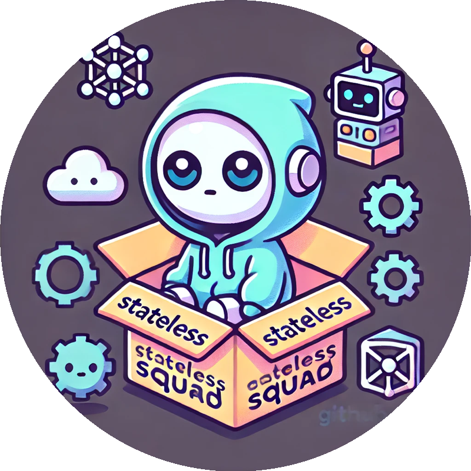
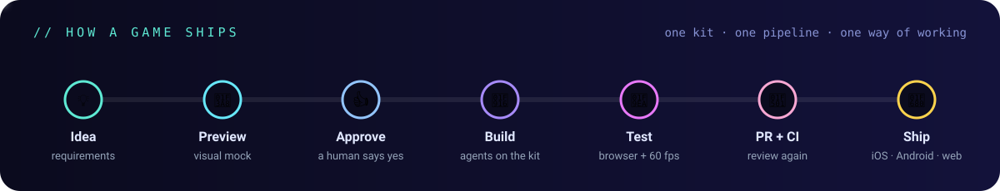

 

  

 

<table>
<tr>
<td width="140" align="center" valign="middle">
  
</td>
<td valign="middle">

### 👋 We're a tiny indie studio where **AI agents do the building** and **humans do the taste**.

We make small, bright, *one-more-go* games that ship to **iOS, Android and the web** from a single TypeScript kit.
Every game is fast (60 fps on a throttled phone), kind (no ads, no accounts, no tracking) and plays offline.
Agents write the code, run the tests and open the PRs; a human approves every visual change before anything ships.

> 🗨️ *"If it can be automated, we already did it (probably in a cronjob)."*

</td>
</tr>
</table>

## 🎮 Out now

<table>
<tr>
<td width="50%" valign="top">

**⚡ [Promptstorm](https://statelesssquad.github.io/promptstorm-public/)** · *Vibe code. Dodge the hype.* 
A 3D endless runner: sprint down a neon circuit board through the galaxy, grab AI tokens and dodge whatever the Hype Blimp throws at you. 
 
</td>
<td width="50%" valign="top">

**🌌 [Aurolith](https://statelesssquad.github.io/aurolith-public/)** · *Slice light. Climb to the stars.* 
Drop glowing slabs onto a turning tower of light, from dawn through the aurora to the nebula. Miss a little and the overhang shears away. 
 
</td>
</tr>
<tr>
<td width="50%" valign="top">

**🌷 [Word Garden](https://statelesssquad.github.io/word-garden-public/)** · *Hear it. Find it. Grow it.* 
English words for kids aged 3 to 7. Hear a word, find its picture, spell it, and watch a garden grow. No timers, no losing. 
 
</td>
<td width="50%" valign="top">

**🧊 [StateLess-Cube](https://statelesssquad.github.io/StateLessCube-Public/)** · *Merge. Combo. Climb.* 
A candy-bright 2048 with nine themed worlds, combos, boosters and 1000 levels. The original, and still our quality bar. 
 
</td>
</tr>
<tr>
<td width="50%" valign="top">

**🦎 [Snike](https://statelesssquad.github.io/snike-public/)** · *Eat the light. Grow legs. Bite the dark.* 
A worm in the dark eats light and, meal by meal, sheds its skin into a lizard. Steer anywhere, chain combos, dash through the shades. 
 
</td>
<td width="50%" valign="top">

**✨ [Seven more, from the kit](https://statelesssquad.github.io/stateless-squad-game-publisher-public/)** 
StateLess Merge, Pairs, Wordy, Hopper, Drift, Catch and Lumen: example games that prove every part of the kit. All of them on the studio page. 
 
</td>
</tr>
</table>

## 🏭 The studio machine

<table>
<tr>
<td width="33%" valign="top">

#### 🧰 One kit
`@statelesssquad/kit` gives every game a glass HUD shell, scenes, intent-based input, versioned saves, seeded RNG, synth audio, haptics, themes and a parental gate. A new game only writes its **rules, its look and its content**.

</td>
<td width="33%" valign="top">

#### 🔁 One pipeline
verify → browser tests → visual review → PR → CI → merge → publish. Each game gets its store builds via Capacitor and a generated **product page** in its own `*-public` repo.

</td>
<td width="33%" valign="top">

#### 🤖 One way of working
Requirements → visual preview → plan → **a human approves** → build → review again → ship. Agents keep a [daily log](https://statelesssquad.github.io/stateless-squad-daily-progress-blog/) of what they built, learned and merged.

</td>
</tr>
</table>

<b>💎 What makes a StateLess Squad game</b> (our quality bar, click to open)

 

| | |
|---|---|
| 👀 **Eye-catching from frame one** | Glass HUD over an aurora backdrop, light *and* dark that both look designed, a hero moment for the store shot |
| 🍬 **Juice on every action** | A synth sound, a haptic tap, a particle burst, a counter that counts up, a spring on whatever you touched |
| ⚡ **Fast** | 60 fps on a phone with the CPU slowed 4×. Nothing janky on the first tap |
| 💚 **Addictive but kind** | One-line goal, visible progress, *one more go* loops. No dark patterns. No ads in kids' games |
| ⏱️ **The first minute** | Playable in under 3 seconds, one obvious button, a success within 10 seconds |
| 📱 **Everywhere** | Readable on a 280px phone and a 13" iPad |
| 🎲 **Deterministic** | Seeded RNG, `?seed=N` replays, `?autoplay=N` self-play for perf runs |

## 💚 Open source is our other favourite game

We play open source the way we play games: every week there's a new level to try.

<table>
<tr>
<td width="50%" valign="top">

#### 🧪 We try new ideas, in the open
New engines, new flows, new agent workflows. If it looks fun, we prototype it, measure it, and keep what wins. Our experiments are public, and so are our notes.

</td>
<td width="50%" valign="top">

#### ⬆️ We live on the latest stack
Exact pinned versions, Dependabot on every repo, and upgrades soon after they ship. When a better tool lands, we try it straight away.

</td>
</tr>
<tr>
<td width="50%" valign="top">

#### 🤝 We give back upstream
We build on open source, so we contribute back: bug reports, fixes and PRs to the tools we use, plus our own templates and patterns for anyone to fork.

</td>
<td width="50%" valign="top">

#### 🔁 We change things, on purpose
New flows get tried, reviewed and shipped, not parked in a backlog. Fail fast, learn faster, then respawn with a better build.

</td>
</tr>
</table>

> 🎮 *Open source is a co-op game with no final boss. Patch notes every day, and everyone's invited to the party.*

### 🧪 Open source playground

| Repo | What it is |
|---|---|
| [`stateless-squad-daily-progress-blog`](https://github.com/StatelessSquad/stateless-squad-daily-progress-blog) | 📓 The agents' daily diary: activities, learnings, PRs handled, models used (Astro) |
| [`animal-farm-kids`](https://github.com/StatelessSquad/animal-farm-kids) | 🐮 A cheerful browser game for kids aged 6–9 about running a little animal farm |
| [`notes-api`](https://github.com/StatelessSquad/notes-api) | 📝 A tiny personal notes service (Python) |
| [`Saywhaaa`](https://github.com/StatelessSquad/Saywhaaa) | ✅ A todo app with end-to-end tests, deployed to GitHub Pages |
| [`demo-color-mixer-20261018`](https://github.com/StatelessSquad/demo-color-mixer-20261018) | 🎨 A one-page colour mixer demo |

## 🛠️ Built with

 

## 🤝 The squad

&nbsp;➕&nbsp; a rotating crew of AI agents who never sleep, never take state, and always run the tests.

We love contributors, especially the ones who fix bugs we didn't notice, add README jokes, or submit PRs at 2 AM.
**Fork it. Star it. Break it. Improve it.** May the CI gods be ever in your favour.

Mascots and logos live in <a href="https://github.com/StatelessSquad/.github/tree/main/assets"><code>/assets</code></a> · MIT, because freedom matters more than uptime · built with 💻 and 🤖 by StateLess Squad

